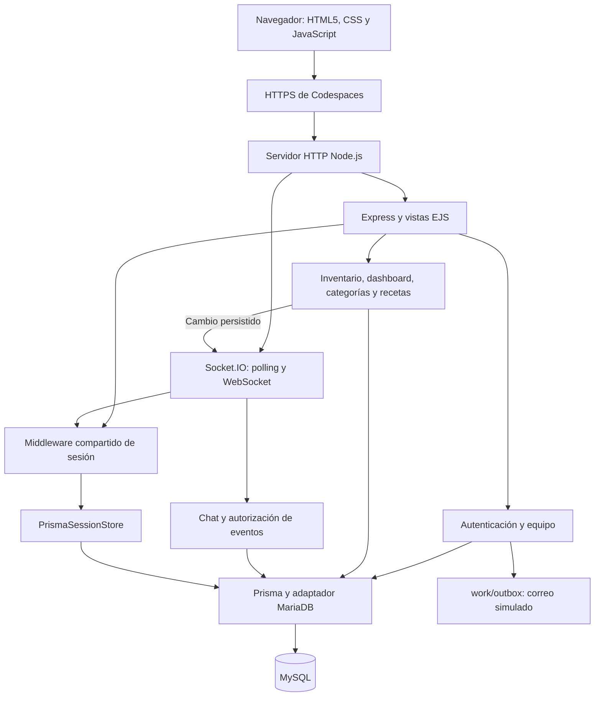
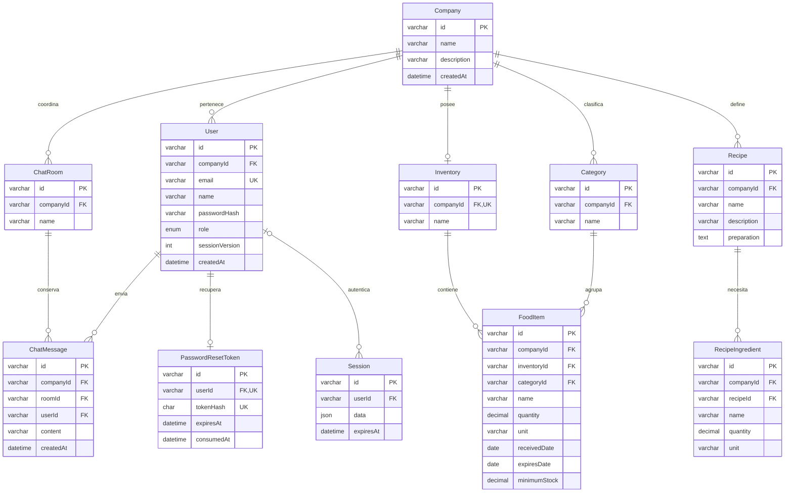

# Referencia técnica

## Arquitectura

Un proceso Node.js 24 integra Express/EJS, lógica de negocio, Prisma y Socket.IO.
MySQL 8.4 almacena datos y sesiones. Los estilos, fuentes y scripts se sirven
localmente. La recuperación utiliza una bandeja privada de correo simulado.

En HTTP local se accede directamente al servidor. `src/server.js` valida el
entorno y la disponibilidad de MySQL antes de escuchar; SIGINT/SIGTERM cierran
HTTP y sockets antes de desconectar Prisma. `/health` comprueba el proceso y
`/ready` la conexión de datos.

| Ubicación | Responsabilidad |
| --- | --- |
| src/app.js, src/server.js | Middleware, rutas, vistas, servidor y ciclo de vida. |
| src/config, src/middleware | Entorno, base de datos, sesiones, autenticación, CSRF y errores. |
| src/modules/auth, users | Registro, login, recuperación y equipo. |
| src/modules/inventory | Validación, consultas paginadas, servicio y rutas de alimentos. |
| src/modules/dashboard, categories, recipes, expiration | Métricas, categorías, recetas y fechas civiles. |
| src/modules/chat | Sala General, historial, eventos, presencia y avisos. |
| src/views, src/public, src/styles | EJS, interacción local y estilos. |
| prisma | Esquema, migraciones y seed ficticio. |
| scripts, tests | Configuración, verificación, mediciones y pruebas automatizadas. |

## Modelo de datos

Las once entidades corresponden a `prisma/schema.prisma`. Las migraciones de
`prisma/migrations/` definen las tablas y sus restricciones SQL.

- `User.email` es único y se normaliza a minúsculas. ADMIN y EMPLOYEE pertenecen
  a una empresa; el rol y companyId se obtienen del usuario autenticado.
- Inventario, nombres de categorías y sala General tienen unicidad por empresa.
  Alimentos, ingredientes y mensajes usan relaciones compuestas con companyId.
- `quantity` y `minimumStock` usan DECIMAL(12,3). Los CHECK exigen valores no
  negativos, ingredientes con cantidad positiva y caducidad igual o posterior
  al ingreso. Las fechas de alimentos usan SQL DATE.
- Los índices de alimentos incluyen `(companyId,name)`, `(companyId,expiresDate)`
  y `(categoryId,companyId)`. El historial indexa `(roomId,companyId,createdAt,id)`.
- Una categoría en uso no se elimina. El borrado público de empresas no está
  expuesto. El seed es ficticio, idempotente y conserva registros existentes.

## Rutas y permisos

| Ruta | Acceso y comportamiento |
| --- | --- |
| /auth/register | Registro público validado; creación atómica de empresa, ADMIN, inventario y General. |
| /auth/login | Verificación contra MySQL y regeneración del ID de sesión. |
| /auth/logout | POST con CSRF; destrucción de sesión y cookie. |
| /auth/forgot, /auth/reset | Recuperación privada con token de un uso y caducidad. |
| /dashboard, /account | Usuario autenticado; métricas y cuenta de su empresa. |
| /team | Solo ADMIN; listado y alta de EMPLOYEE de la misma empresa. |
| /inventory, /inventory/:id | Consulta, filtros, paginación y detalle de la empresa. |
| /inventory/new, /inventory/:id/edit | ADMIN y EMPLOYEE crean o editan alimentos. |
| /inventory/:id/delete | Solo ADMIN; GET muestra confirmación y POST elimina con checkbox y CSRF. |
| /categories | Consulta autenticada; crear, renombrar y eliminar corresponde a ADMIN. |
| /expiration, /recipes, /recipes/:id | Consulta autenticada limitada a la empresa. |
| /chat | Sala General e historial de la empresa autenticada. |

El inventario valida nombre de 2–120 caracteres, categoría autorizada, cantidad
y mínimo entre 0 y 999999999.999 con hasta tres decimales, unidad permitida y
fechas reales de los años 1000–9999. Las unidades son kg, g, l, ml y unidad.
La búsqueda combina nombre/categoría, categoría exacta y estado. Se consultan
10 registros por página, ordenados por caducidad e ID.

La fecha del negocio se calcula en BUSINESS_TIMEZONE: caducado antes de hoy,
crítico de hoy a dos días, advertencia de tres a cinco y normal desde seis.
Stock bajo significa cantidad menor o igual al mínimo. El dashboard muestra
los cuatro contadores y las primeras alertas.

Las recetas contienen ingredientes y pasos. Las sugerencias usan coincidencia
bidireccional de nombres sin distinguir mayúsculas y excluyen alimentos
caducados o sin stock; no garantizan suficiencia de cantidades ni convierten
unidades. Los datos se renderizan escapados en EJS.

## Autenticación y seguridad

- Contraseñas: Argon2id con 19456 KiB, dos iteraciones y paralelismo uno. Las
  entradas se validan en HTML5/JavaScript y Zod; no se aceptan campos extra.
- Sesión: MySQL mediante PrismaSessionStore, duración de ocho horas, cookie
  HttpOnly/SameSite=Lax y Secure en HTTPS. Registro/login regeneran el ID;
  logout destruye la sesión. Rol, empresa y sessionVersion se vuelven a consultar.
- Recuperación: token aleatorio de 256 bits, hash SHA-256 en MySQL, caducidad de
  30 minutos y consumo condicional atómico. Un enlace nuevo reemplaza al previo;
  el cambio de clave incrementa la versión y elimina sesiones anteriores.
- Formularios: token CSRF vinculado a sesión con comparación constante y control
  de origen. Para Origin:null se conserva compatibilidad con el token cuando
  falta Fetch Metadata; si está presente se exige same-origin. La alternativa
  de origen reescrito requiere TRUST_PROXY=1, HTTPS y Sec-Fetch-Site:same-origin.
  Las solicitudes cross-site explícitas se rechazan.
- Consultas y contenido: Prisma/Prisma.sql parametrizados, escape EJS y
  textContent para datos en vivo; Helmet/CSP restringe recursos al mismo origen.
- Límites de cuentas: diez intentos por IP cada quince minutos en login,
  registro, recuperación, reset y alta de empleados. Errores públicos genéricos;
  los diagnósticos de formularios contienen referencias y banderas sin secretos.

`.env`, sesiones, cookies, enlaces de recuperación y `work/outbox/` no se
publican. El secreto de sesión se configura por entorno; en producción se exige
APP_ORIGIN HTTPS. La bandeja simulada usa directorio 0700 y archivos 0600.

## Socket.IO: handshake y contratos

Engine.IO utiliza el mismo middleware y almacén de sesión que Express. El
namespace exige `auth.csrfToken`, sesión vigente y usuario actual. Se valida
el origen exacto; los GET de polling sin Origin requieren Fetch Metadata
same-origin. La alternativa por proxy exige HTTPS y TRUST_PROXY=1. Se rechazan
orígenes y señales de sitio ajenos fuera de esas condiciones.

La identidad, empresa y General se resuelven en MySQL. Cada evento y destinatario
se reautoriza por sesión, caducidad y versión; un barrido de 15 segundos retira
conexiones revocadas. La actividad del socket no renueva sesiones antiguas.

| Evento | Dirección y contrato |
| --- | --- |
| chat:ready | Servidor → cliente: `{roomId,userId}`. |
| chat:send | Cliente → servidor: `{roomId,content}`; ack `{ok:true,message}` tras persistir. |
| chat:message | Servidor → empresa: `{id,roomId,content,createdAt,sender:{id,name}}`. |
| chat:history | Cliente → servidor: `{roomId,before?}`; ack `{ok:true,messages,hasMore}`. |
| chat:presence | Servidor → empresa: `{users:[{id,name}]}`; un usuario se cuenta una vez aunque abra varias pestañas. |
| inventory:changed | Servidor → empresa: `{itemId,action,name,expiration,nearExpiry}` tras crear, editar o eliminar un alimento. |

Los eventos solicitados requieren callback. Los errores usan
`{ok:false,code,message}` con AUTH_REQUIRED, INVALID_INPUT, FORBIDDEN, RATE_LIMIT
o CHAT_UNAVAILABLE; el handshake también puede devolver CONNECTION_LIMIT.
El historial devuelve hasta 50 mensajes con cursor autorizado y orden
cronológico estable por fecha/ID. El emisor recibe el evento y se deduplica por ID.

Los mensajes admiten texto Unicode recortado de 1–2000 caracteres, sin controles
no imprimibles. Se limitan cinco conexiones por usuario, 100 por empresa,
60 solicitudes de envío/historial por minuto y usuario, y paquetes de 16 KiB.
El cliente espera diez segundos por confirmación y conserva el texto si falla.

El transporte inicia con polling y negocia WebSocket; en HTTPS se usa wss.
Sin upgrade se mantiene polling. Al reconectar se sincroniza el historial
reciente. No se reintentan envíos automáticamente, pues un ack perdido puede
corresponder a un mensaje persistido.

Los avisos aparecen sin recargar; las tablas y métricas conservan su consulta
inicial y el banner enlaza al inventario actualizado. Los avisos no tienen
historial propio. Mensajes y sesiones persisten; presencia y límites residen
en memoria del único proceso. No se garantiza entrega exactamente una vez.
